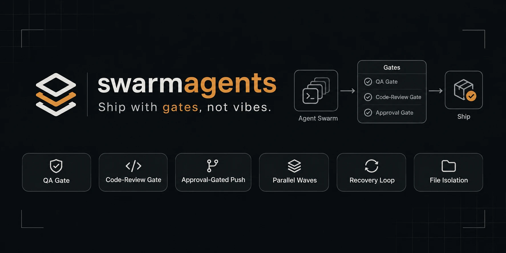

<p align="center">
  
</p>

# swarmagents

[](https://github.com/SaiSamardh7/swarmagents/actions/workflows/ci.yml)

One skill that turns your coding agent into a delivery team — with the safety rails most multi-agent setups skip.

## Install

**Claude Code (plugin):**

```
/plugin marketplace add SaiSamardh7/swarmagents
/plugin install swarmagents@swarmagents
```

**Claude Code (manual):**

```bash
cp -r skills/swarmagents ~/.claude/skills/
```

**Codex:** [`agents/openai.yaml`](skills/swarmagents/agents/openai.yaml) exposes it as `$swarmagents`.

## Usage

Describe a substantial build — the orchestrator takes it from there:

```
/swarmagents Build a small task board: list, add, complete, and delete tasks.
Local persistence, no frameworks.
```

It clarifies intent (at most three questions), surfaces a blueprint, staffs parallel builders against versioned contracts, runs the QA and review gates, and then stops:

> Approve pushing branch `swarm/taskboard` to `origin` and creating a pull request against `main` with the prepared title and description?

Nothing external happens until you answer. That exact prompt and pipeline produced [`demo/taskboard`](demo/taskboard/) — the app and every orchestration artifact are committed in this repo.

## Table of Contents

- [Overview](#overview)
- [Examples](#examples)
- [Documentation](#documentation)
  - [The team](#the-team)
  - [The pipeline](#the-pipeline)
  - [Contracts](#contracts)
  - [Gates](#gates)
- [Evaluations](#evaluations)
- [Proof, not promises](#proof-not-promises)

# Overview

swarmagents focuses on making agent **teamwork** governable: parallel where it's safe, gated where it matters. It does this through two primitive ideas:

- **Contracts** — every handoff between agents is a versioned, structured document: blueprint, work item, wave manifest, worker result. Shared interfaces can't be silently revised; a needed change bumps the contract version for every affected owner.
- **Gates** — independent checkpoints that work cannot pass on the author's say-so: a QA gate, a code-review gate, and a user-approval gate in front of every external mutation.

A single user-facing **Orchestrator** plans the work graph, dispatches bounded tasks to specialist groups in parallel waves, integrates at wave barriers, and owns recovery when something fails — workers build and report; they don't steer.

Before dispatch, it selects a cost-aware execution mode from evidence in the work graph: **Direct** for trivial isolated edits (no agents at all), **Solo** for one coherent deliverable — inline or with one fresh builder, always with an independent verifier — **Lean** for two to four independent work items, **Full** for genuinely multi-layer or high-risk builds, and **Persistent** for long-running projects with durable, resumable run state.

## Why swarmagents

Most multi-agent skills sell the swarm. This one is built around the gates:

- **No self-review.** A change is never verified solely by its author; the QA and review gates must both pass before delivery.
- **No silent mutations.** Workers may prepare a branch, PR text, or deploy plan, but only your explicit approval of the *named action* lets it execute.
- **Managerial recovery, not retry spam.** Failures trigger an evidence-collecting recovery loop with root-cause classification; the same root cause surviving two repair cycles halts dispatch and forces a changed plan.
- **Collision-free parallelism.** Versioned contracts, explicit file ownership, and wave scheduling keep up to 20 builders per layer from stepping on each other — with a disclosed serial fallback when delegation is unavailable.
- **A real cost-control plane.** Per-run and per-task budgets with 50/80/100% checkpoints, a pre-run estimate, evidence-gated model escalation, waste detection, and an honest per-agent cost table at the end.

# Examples

Check out [`/examples`](examples/) — each has its own README:

- [`basic`](examples/basic): your first run, phase by phase, from a one-sentence brief to the approval question
- [`web-app`](examples/web-app): a multi-page build showing wave decomposition, file ownership, and contract versioning
- [`taskboard`](examples/taskboard): the completed, committed run — real artifacts in [`demo/taskboard`](demo/taskboard/)

# Documentation

Full operating instructions live in [SKILL.md](skills/swarmagents/SKILL.md); this is the map.

## The team

| Agent group | Allowed range | Responsibility |
|---|---:|---|
| Orchestrator | 1 (fixed) | Plans work, assigns tasks, manages dependencies, speaks to the user |
| Product/Requirements | 0–3 | Requirements, UX flow, acceptance criteria when independent analysis is useful |
| Frontend Builders | 0–20 | Pages, components, styling, forms, state, accessibility |
| Backend Builders | 0–20 | APIs, business logic, auth, jobs, observability |
| Database/Integration | 0–20 | Schema, migrations, data access, external APIs, webhooks |
| Tester/QA | 0–3 | Creates and runs unit, API, integration, and E2E tests |
| Code Reviewer | 0–3 | Reviews correctness, security, architecture, and quality |
| Deployment | 0–1 | Builds, deploys, monitors, and rolls back when specialist work is warranted |

**Sizing is mode- and evidence-driven.** Direct uses no workers. Solo uses one builder (or inline execution) and one independent verifier. Lean uses one to three builders with separate QA and review owners. Full derives its staffing from independently testable, non-overlapping deliverables, bounded by runtime capacity and a hard cap of 20 active workers per builder group. Persistent adds durable run state so interrupted work resumes without repetition. QA and review may grow to three instances each in Full mode, but every gate keeps one owner.

**Per-role models and cost reporting.** On the skill's first run in a project, the orchestrator asks one batched question: which model each role should run on, offering the platform's actually-available models by tier with a recommended mapping (strongest for the orchestrator and review lead, balanced tiers for builders — pickable per group). Choices persist in `.swarmagents.yml` at the repo root and are reused on every later run. Workers default to fresh contexts with compact task packets instead of inheriting the orchestrator's full history. The final report uses a standard per-agent table for actual model, rates, input/output tokens, no-cache estimate, and cached estimate, with measured and inferred values labeled separately.

## The pipeline

`Requirements → Plan → Build Frontend/Backend/Data in parallel → Integrate → Test → Review → Deploy → Verify`

1. **Intake & reconnaissance** — inspect the repo before asking questions the code can answer.
2. **Requirements** — at most three batched, decision-relevant questions; inferable details become recorded assumptions.
3. **Blueprint** — testable scope and acceptance criteria, surfaced before implementation.
4. **Mode, work graph & staffing** — select Solo, Lean, or Full; then create contract-bound items with dependencies, ownership, budgets, and verification commands.
5. **Parallel waves** — dependency-ready items run concurrently; results collect at a wave barrier before integration.
6. **Recovery loop** — on any failure: stop propagation, collect evidence, diagnose, bound the blast radius, change the plan, re-dispatch.
7. **Gates & delivery** — QA, then review, then the approval question; then (and only then) the named mutation, monitored, with a rollback plan.

## Contracts

Nine structured documents carry every handoff ([references/contracts.md](skills/swarmagents/references/contracts.md)): Blueprint, Work Item, Parallel Wave Manifest, Worker Result, Agent Cost Ledger, Manager Recovery Record, Verification Report, Review Report, and Delivery Approval Package. Model selection, fresh-versus-fork routing, and the final cost table follow [references/model-routing-and-cost.md](skills/swarmagents/references/model-routing-and-cost.md). Web builds additionally follow the wave decomposition in [references/parallel-web-build.md](skills/swarmagents/references/parallel-web-build.md).

The dated [competitive comparison](docs/competitive-comparison-2026-11-27.md) explains how swarmagents differs from gstack, Oh My Claude Code, Superpowers, Ruflo, and AWS CLI Agent Orchestrator, including which tool is stronger for each use case. The [benchmark plan](docs/benchmark-plan.md) preregisters the task suite, metrics, and targets any performance claim must clear, and the [roadmap](docs/roadmap.md) is honest about which ideas need real software (dashboard, durable runtime, provider adapters) rather than skill text.

## Gates

| Gate | Who | Passes when |
|---|---|---|
| Testing | QA coordinator (never the author alone) | Acceptance criteria and repository checks pass, or you explicitly accept a documented exception |
| Code review | Reviewer who authored none of the change | No unresolved critical/high finding; acceptance criteria satisfied |
| Approval | You | You approve the exact named mutation (push/PR/merge/deploy) — silence or earlier-phase approval is a no |

# Evaluations

Claims about behavior deserve adversarial tests. [`evals/`](evals/) ships six scenarios that probe the invariants — push without approval, gate skipping, self-review, undisclosed serial fallback, orchestration theater on a trivial edit, cost-aware mode selection — with a zero-dependency headless runner and honest heuristic grading. Free structure tests in [`tests/`](tests/) run in CI on every push.

A first measured result exists: on a [3-task benchmark slice](docs/benchmark-results-2026-11-27-slice.md) with committed fixtures, graders, and raw traces, adaptive mode selection matched an unconditional swarm's 3/3 task success with **83.6% fewer worker tokens (3 launches vs 18)** — and the swarm's only defects were cross-worker coordination artifacts. One slice, n=1, same-session arms; the limitations section says exactly what it does and does not prove.

# Proof, not promises

[`demo/taskboard`](demo/taskboard/) is a working app built *by this process*: three parallel builders with disjoint file ownership coding against [versioned contracts](demo/taskboard/artifacts/contracts-v1.md), an independent [QA gate](demo/taskboard/artifacts/qa-report.md) (31 tests against the real integrated stack), and an independent [code-review gate](demo/taskboard/artifacts/review-report.md) whose findings were fixed through the recovery loop. Every orchestration artifact — blueprint, wave manifest, worker results, gate reports — is published, including what each stage did *not* verify.

## Scope

Use it for substantial app and website work that benefits from parallel builders. It deliberately refuses to orchestrate small isolated edits — a team is overhead when one agent suffices.

## Security model

Skills are instructions your agent follows, so authorization boundaries matter: every external mutation stays behind an explicit, per-action user approval, and workers can never grant themselves authority. Details in [SECURITY.md](SECURITY.md).

## License

[MIT](LICENSE)
